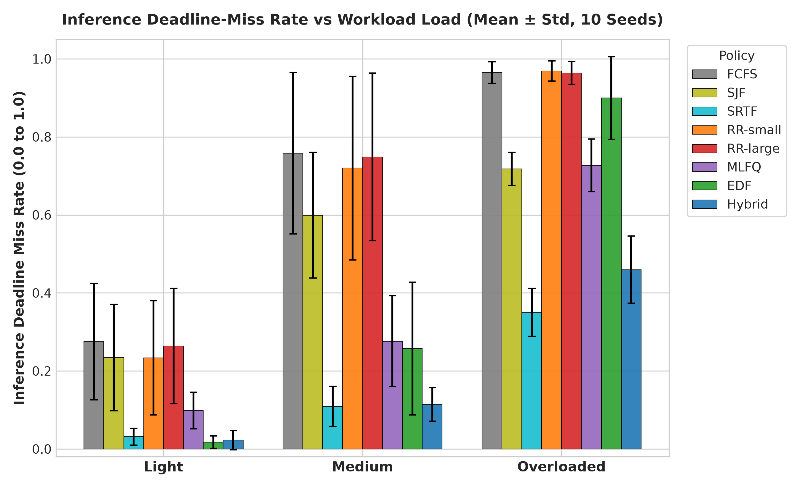
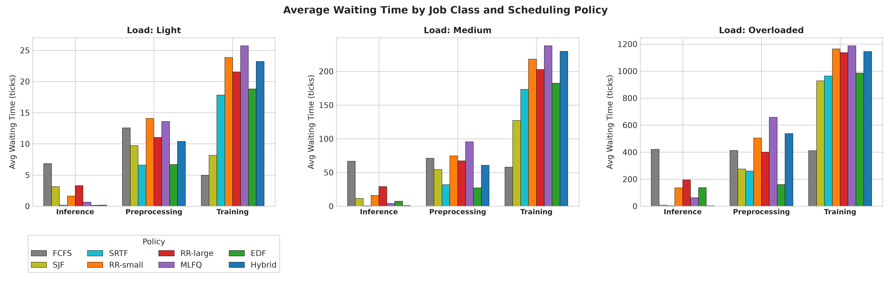
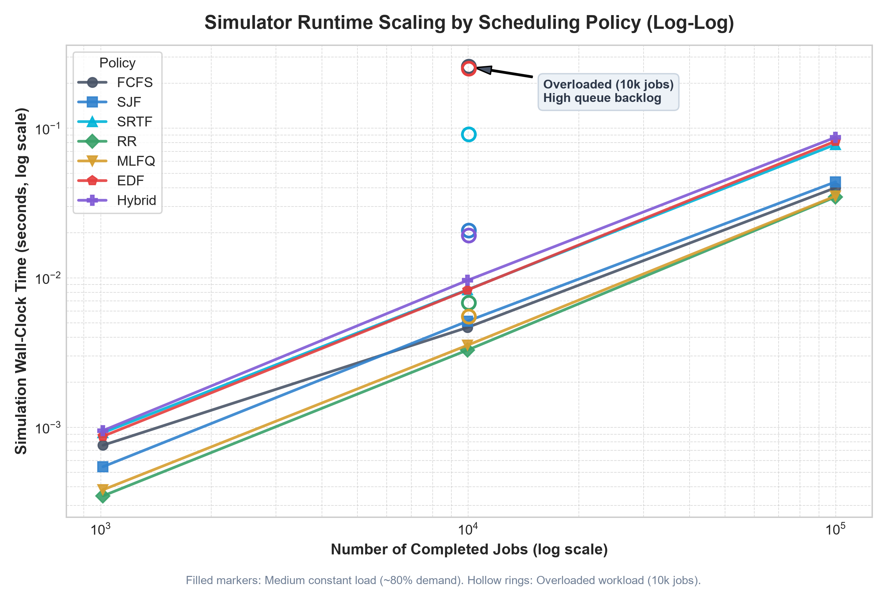

# ML Job Scheduler Simulator

A discrete-event scheduling simulator in C++14 designed to evaluate and compare CPU/GPU scheduling policies on heterogeneous machine learning workloads. Modern machine learning infrastructure concurrently hosts a diverse mix of workloads with diametrically opposed scheduling objectives: long-running, throughput-bound model training jobs; bursty, deadline-sensitive online inference requests with strict service-level agreements (SLAs); and batch data preprocessing pipelines. Classical operating system scheduling algorithms (such as FCFS, Round Robin, or Shortest Job First) treat all jobs as interchangeable CPU bursts, resulting in head-of-line blocking where multi-hour training tasks starve inference requests, or uncoordinated time-slicing where latency SLAs collapse. This simulator models workload arrival distributions, execution bursts, and deadline slack factors across multi-tier priorities, comparing standard CPU scheduling policies against a custom, workload-aware Hybrid scheduler.

---

## Scheduling Policies

- **FCFS (First-Come, First-Served):** Non-preemptive queue that schedules jobs strictly in chronological order of arrival.
- **SJF (Shortest Job First):** Non-preemptive policy selecting the ready job with the smallest total burst time.
- **SRTF (Shortest Remaining Time First):** Preemptive policy dynamically selecting the job with the shortest remaining burst time.
- **RR-small ($q=2$):** Preemptive Round Robin with a small time quantum matching median inference burst length.
- **RR-large ($q=8$):** Preemptive Round Robin with a larger time quantum matching medium-priority batch work.
- **MLFQ (Multi-Level Feedback Queue):** Three-tier priority scheduler ($q_0=2$, $q_1=8$, $q_2=\infty$ FCFS) with periodic global priority boosts every 100 ticks to mitigate starvation.
- **EDF (Earliest Deadline First):** Preemptive policy scheduling the job with the earliest absolute deadline via a min-heap.
- **Hybrid:** Workload-aware, three-tier scheduler combining deadline-driven inference preemption, feedback tiers, starvation aging, and guaranteed background progress.

### Hybrid Scheduler Architecture

The Hybrid scheduling policy is designed to solve the tension between strict inference deadlines and background training throughput:

1. **Tier 0 (Inference / High Priority):** Dedicated to latency-sensitive inference jobs. Jobs within Tier 0 are ordered dynamically using Earliest Deadline First (EDF). Any job arriving in Tier 0 immediately preempts execution in lower tiers.
2. **Tier 1 (Preprocessing & Demoted Jobs / Medium Priority):** Round Robin queue with a quantum of $q=8$ ticks. Serves batch preprocessing tasks and inference jobs whose execution burst exceeded their initial allocation.
3. **Tier 2 (Training / Low Priority):** Round Robin queue with a long quantum of $q=16$ ticks, minimizing context switching overhead for long-running training jobs.
4. **Anti-Starvation Aging:** Any job waiting in Tier 2 for $\ge 200$ ticks is automatically promoted to Tier 1, bounding maximum wait time.
5. **Reserved Training Capacity ($K=10$):** Guarantees that at least 1 out of every 10 ticks is allocated to Tier 2 training work, preventing an unbroken barrage of inference arrivals from completely freezing training progress.

---

## Requirements

- **C++ Compiler:** `g++.exe (MinGW-W64 x86_64-ucrt-posix-seh, built by Brecht Sanders, r2) 16.2.0` (C++14 standard, STL only, no external libraries or CMake required).
- **Python:** Python 3.x with `matplotlib`, `numpy`, and `pandas` for experimental analysis and figure generation.
- **Environment:** Windows PowerShell (or Command Prompt).

---

## Quickstart & Commands

All build, test, and evaluation commands can be executed directly in PowerShell from the repository root:

### 1. Build
Compiles `sim.exe`, `experiments.exe`, and `benchmark.exe`:
```powershell
.\build.bat
```

### 2. Run Tests
Executes the full unit and integration test suite across all policies, metrics, and workload generators:
```powershell
.\test.bat
```

### 3. Run Experiments
Executes the comparative benchmark evaluating 8 policies across 3 load configurations and 10 random seeds:
```powershell
.\experiments.exe
```

### 4. Generate Plots & Paired Analysis
Generates all visualization figures and the paired statistical comparison:
```powershell
python scripts\plot.py
python scripts\paired.py
```

### 5. Run Scaling Benchmark
Executes the scaling suite (1k to 100k jobs) with `-O2` optimizations and generates the scaling plot:
```powershell
.\benchmark.exe
python scripts\plot_scaling.py
```

### 6. Run Simulator CLI
Execute a single simulation on a custom CSV or generate a synthetic trace:
```powershell
.\sim.exe data\sample_jobs.csv
.\sim.exe --generate data\workload_light.cfg data\generated_light.csv
```

---

## Repository Layout

```text
ml-job-scheduler-sim/
├── build.bat               # Compiles sim.exe, experiments.exe, and benchmark.exe
├── test.bat                # Automated test runner for unit and integration suites
├── data/                   # Workload configurations and sample job traces
│   ├── sample_jobs.csv
│   ├── workload_light.cfg
│   ├── workload_medium.cfg
│   └── workload_overloaded.cfg
├── docs/                   # Specifications, experimental reports, and figures
│   ├── AGENT_RULES.md      # Development constraints and rules
│   ├── PAIRED.md           # 10-seed paired statistical analysis (Hybrid vs others)
│   ├── RESULTS.md          # Full experimental results, tables, and analysis
│   ├── SCALING.md          # Algorithmic complexity and scaling benchmark report
│   ├── SPEC.md             # Project requirements and architecture specification
│   ├── scaling.csv         # Scaling benchmark measurement data
│   └── figures/            # Visualizations and publication plots
│       ├── fig1_inference_deadline_miss_rate.png
│       ├── fig2_waiting_time_by_class.png
│       ├── fig3_training_starvation.png
│       ├── fig4_throughput.png
│       ├── fig5_gantt_chart.png
│       └── scaling.png
├── include/                # Core C++ header definitions
│   ├── csv_loader.hpp
│   ├── job.hpp
│   ├── metrics.hpp
│   ├── scheduler.hpp
│   ├── simulator.hpp
│   └── workload.hpp
├── results/                # Output CSV files and verification checksums
│   ├── golden_after.txt    # Post-optimization verification checksums
│   ├── golden_before.txt   # Baseline pre-optimization verification checksums
│   ├── runs_raw.csv        # Per-seed simulation runs across all configurations
│   ├── summary.csv         # Aggregated means and standard deviations
│   ├── timeline_hybrid.csv # Execution timeline for Hybrid Gantt chart
│   └── timeline_rr.csv     # Execution timeline for Round Robin Gantt chart
├── scripts/                # Analysis and plotting scripts
│   ├── paired.py           # Computes paired seed differences and win rates
│   ├── plot.py             # Generates Figures 1 to 5 from experimental CSVs
│   └── plot_scaling.py     # Generates log-log scaling plot
├── src/                    # Implementation source files
│   ├── benchmark.cpp       # Scaling benchmark harness
│   ├── experiment.cpp      # 10-seed experimental benchmark harness
│   ├── main.cpp            # Command-line interface for simulator
│   ├── metrics.cpp         # Metrics computation and CSV export
│   ├── simulator.cpp       # Core discrete-event simulation engine
│   ├── workload.cpp        # Synthetic workload generator (Poisson / Gamma)
│   └── policies/           # Modular scheduling policies
│       ├── edf.cpp / .hpp
│       ├── fcfs.cpp / .hpp
│       ├── hybrid.cpp / .hpp
│       ├── mlfq.cpp / .hpp
│       ├── rr.cpp / .hpp
│       ├── sjf.cpp / .hpp
│       └── srtf.cpp / .hpp
└── tests/                  # Unit tests for policies and components
    ├── test_edf.cpp
    ├── test_fcfs.cpp
    ├── test_hybrid.cpp
    ├── test_metrics.cpp
    ├── test_mlfq.cpp
    ├── test_rr.cpp
    ├── test_sjf.cpp
    ├── test_srtf.cpp
    └── test_workload.cpp
```

---

## Key Results

The benchmark evaluates 8 scheduling policies across three load levels (**light**, **medium**, **overloaded**) over 10 random seeds (seeds 1 to 10). The numbers below are transcribed directly from [docs/RESULTS.md](docs/RESULTS.md).

### 1. Inference Deadline-Miss Rate Comparison

Mean and standard deviation across 10 evaluation seeds:

| Workload Load | Hybrid | RR-small ($q=2$) | RR-large ($q=8$) | EDF | MLFQ |
|:---|:---:|:---:|:---:|:---:|:---:|
| **Light** | $0.0225 \pm 0.0249$ | $0.2335 \pm 0.1465$ | $0.2636 \pm 0.1479$ | $0.0178 \pm 0.0160$ | $0.0989 \pm 0.0471$ |
| **Medium** | $0.1141 \pm 0.0425$ | $0.7199 \pm 0.2357$ | $0.7486 \pm 0.2150$ | $0.2575 \pm 0.1702$ | $0.2761 \pm 0.1164$ |
| **Overloaded** | $0.4598 \pm 0.0861$ | $0.9689 \pm 0.0255$ | $0.9638 \pm 0.0290$ | $0.8995 \pm 0.1054$ | $0.7270 \pm 0.0676$ |

### 2. Reduction in Inference Deadline Misses

Reduction achieved by Hybrid relative to standard Round Robin variants:

| Workload Load | vs. RR-small ($q=2$) | vs. RR-large ($q=8$) |
|:---|:---:|:---:|
| **Light** | **90.37%** ($0.2335 \to 0.0225$) | **91.47%** ($0.2636 \to 0.0225$) |
| **Medium** | **84.15%** ($0.7199 \to 0.1141$) | **84.75%** ($0.7486 \to 0.1141$) |
| **Overloaded** | **52.54%** ($0.9689 \to 0.4598$) | **52.29%** ($0.9638 \to 0.4598$) |

### 3. Visualizations


*Figure 1: Mean inference deadline-miss rate across workload load levels.*


*Figure 2: Mean waiting time broken down by job class across workload loads.*


*Figure 3: Empirical scaling of simulation runtime vs. job count (1k to 100k jobs).*

### 4. Scaling Performance (Post-Optimization)

Following the removal of per-tick linear scans, persistent set replacements, and swap-and-pop queue operations (documented in [docs/SCALING.md](docs/SCALING.md)), the simulator scales linearly across two orders of magnitude:

| Policy | Medium 1k (s) | Medium 10k (s) | Medium 100k (s) | Overloaded 10k (s) | Overloaded vs Med 10k Slowdown |
|:---|:---:|:---:|:---:|:---:|:---:|
| **FCFS** | 0.00035 | 0.00334 | 0.03302 | 0.00522 | **1.56x** |
| **SJF** | 0.00047 | 0.00442 | 0.04387 | 0.02135 | **4.83x** |
| **SRTF** | 0.00045 | 0.00418 | 0.03931 | 0.00506 | **1.21x** |
| **RR ($q=3$)** | 0.00037 | 0.00379 | 0.03564 | 0.00435 | **1.15x** |
| **MLFQ** | 0.00040 | 0.00374 | 0.03448 | 0.00550 | **1.47x** |
| **EDF** | 0.00041 | 0.00446 | 0.03874 | 0.00579 | **1.30x** |
| **Hybrid** | 0.00039 | 0.00385 | 0.04197 | 0.00554 | **1.44x** |

**Empirical Scaling Ratio $T(\text{100k}) / T(\text{10k})$ on Medium Workload ($10.04\times$ job scale):**

| Policy | $T(\text{10k})$ (s) | $T(\text{100k})$ (s) | Ratio $\frac{T(\text{100k})}{T(\text{10k})}$ | Expected Ratio | Status |
|:---|:---:|:---:|:---:|:---:|:---:|
| **FCFS** | 0.00334 | 0.03302 | **9.88** | 10 – 12 | Normal |
| **SJF** | 0.00442 | 0.04387 | **9.93** | 10 – 12 | Normal |
| **SRTF** | 0.00418 | 0.03931 | **9.41** | 10 – 12 | Normal |
| **RR ($q=3$)** | 0.00379 | 0.03564 | **9.40** | 10 – 12 | Normal |
| **MLFQ** | 0.00374 | 0.03448 | **9.21** | 10 – 12 | Normal |
| **EDF** | 0.00446 | 0.03874 | **8.68** | 10 – 12 | Normal |
| **Hybrid** | 0.00385 | 0.04197 | **10.90** | 10 – 12 | Normal |

---

## Where Hybrid Does Not Win

Because Hybrid explicitly prioritizes inference deadlines and reserves capacity for training progress, other policies outperform Hybrid on metrics where different tradeoffs are favored. The seed-by-seed paired comparisons across all 10 evaluation seeds (detailed in [docs/PAIRED.md](docs/PAIRED.md)) quantify the exact win/loss counts:

### Light Load
- **Inference Deadline-Miss Rate vs. EDF:** Pure EDF achieves a lower mean miss rate ($0.0178 \pm 0.0160$ vs. Hybrid's $0.0225 \pm 0.0249$). In paired seeds, Hybrid wins 1/10 seeds, ties 6/10 seeds, and EDF wins 3/10 seeds. Because Hybrid guarantees 1 out of every 10 ticks ($K=10$) to Tier 2 training, an inference job with an imminent deadline can occasionally miss when displaced by a reserved background tick.
- **Inference Waiting Time:**
  - vs. **SRTF** ($0.1162$ vs. Hybrid $0.2079$): Hybrid wins 5/10 seeds, ties 1/10 seeds (not distinguishable from noise).
  - vs. **EDF** ($0.1504$ vs. Hybrid $0.2079$): EDF wins 8/10 seeds, ties 1/10 seeds, Hybrid wins 1/10 seeds.
- **Response Time vs. MLFQ:** MLFQ achieves lower overall average response time ($0.3804$ vs. Hybrid's $1.2678$, Hybrid wins 0/10 seeds) and preprocessing response time ($0.8872$ vs. Hybrid's $3.5786$, Hybrid wins 0/10 seeds) because all arriving jobs enter the top priority queue immediately upon arrival.
- **Training Waiting Time:** FCFS ($20.94$, Hybrid wins 0/10 seeds, ties 1/10) and SJF ($28.31$, Hybrid wins 0/10 seeds, ties 1/10) achieve lower average training waiting time than Hybrid ($44.64$).

### Medium Load
- **Inference Deadline-Miss Rate vs. SRTF:** SRTF achieves a slightly lower inference miss rate ($0.1091$ vs. Hybrid's $0.1141$, Hybrid wins 3/10 seeds, ties 1/10 seeds, SRTF wins 6/10 seeds) and lower inference waiting time ($0.6178$ vs. Hybrid's $0.7234$, Hybrid wins 2/10 seeds, ties 1/10 seeds) by greedily prioritizing remaining burst length.
- **Overall Waiting & Turnaround Time:** SRTF (avg wait $13.25$, turnaround $19.14$, Hybrid wins 0/10 seeds) and EDF (avg wait $17.50$, turnaround $23.39$, Hybrid wins 1/10 seeds) outperform Hybrid (avg wait $21.78$, turnaround $27.67$).
- **Training Wait Degradation:** Prioritizing Tier 0 inference causes training jobs to wait longer under Hybrid ($229.66$) than under FCFS ($58.03$, Hybrid wins 0/10 seeds), SJF ($127.18$, Hybrid wins 0/10 seeds), SRTF ($173.30$, Hybrid wins 0/10 seeds), and EDF ($182.57$, Hybrid wins 0/10 seeds, ties 1/10).
- **Preprocessing Deadlines:** Preprocessing miss rate is higher under Hybrid ($0.8297$) than under SRTF ($0.4792$, Hybrid wins 0/10 seeds), EDF ($0.5266$, Hybrid wins 0/10 seeds), and SJF ($0.6665$, Hybrid wins 0/10 seeds, ties 1/10).

### Overloaded Load
- **Inference Deadline-Miss Rate vs. SRTF:** Under heavy overload, SRTF achieves a $0.3505 \pm 0.0768$ miss rate compared to Hybrid's $0.4598 \pm 0.0861$ (Hybrid wins 0/10 seeds, SRTF wins 10/10 seeds).
- **Overall Average Waiting Time:** SRTF ($82.08$, Hybrid wins 0/10 seeds) and SJF ($87.28$, Hybrid wins 0/10 seeds) achieve lower overall waiting times than Hybrid ($144.17$).
- **Training Waiting Time:** FCFS ($410.94$, Hybrid wins 0/10 seeds), SJF ($928.86$, Hybrid wins 0/10 seeds), SRTF ($963.51$, Hybrid wins 0/10 seeds), and EDF ($986.66$, Hybrid wins 0/10 seeds) all achieve lower training wait times than Hybrid ($1145.71$).
- **Preprocessing Starvation:** Preprocessing jobs that demote to Tier 2 experience high wait times ($537.46$ under Hybrid vs. $159.90$ under EDF [Hybrid wins 0/10] and $261.13$ under SRTF [Hybrid wins 0/10]) and a $1.0000$ deadline miss rate.
- **Maximum Waiting Time (Starvation):** FCFS bounds maximum wait time across all jobs to $856.10$ ticks (Hybrid wins 0/10 seeds), whereas Hybrid reaches $1450.50$ ticks for long training jobs delayed by inference bursts.

---

## Limitations

1. **Discrete-Time Simulation:** Time advances in discrete integer ticks. The simulator does not model continuous wall-clock time, context-switch penalties, interrupt handling latency, or CPU cache misses.
2. **Synthetic Workloads:** Workloads are stochastically generated using Poisson arrivals and Gamma/Uniform burst distributions. While parameterized to represent typical ML tasks, they do not replicate production cluster traces (e.g., Azure ML, Philly).
3. **Single CPU Core:** The simulation models a single uniprocessor core. It does not model multi-core concurrency, GPU stream multiprocessing, PCIe transfer bottlenecks, or distributed job scheduling.
4. **Memory Constraint Field (`mem_req`):** Although the `Job` struct includes a `mem_req` attribute, **no scheduling policy currently utilizes `mem_req`** for admission control or resource packing. Jobs are scheduled strictly on time and deadline constraints.
5. **Trade-Off Penalty for Non-Inference Jobs:** Protecting inference latency comes with an inescapable cost: training and batch preprocessing tasks experience substantially longer waiting and turnaround times under Hybrid than under throughput-oriented policies like FCFS, SJF, or SRTF.

---

## Reproducibility

Every result, summary table, and visualization is deterministically reproducible from fixed random seeds:

- **10 Evaluation Seeds:** Seeds 1 through 10 are specified in the experiment harness (`src/experiment.cpp`) and configuration files (`data/workload_light.cfg`, `data/workload_medium.cfg`, `data/workload_overloaded.cfg`).
- **Gantt Chart Seed:** Seed 42 is used for the light workload trace in Figure 5 (`results/timeline_hybrid.csv`).
- **Scaling Benchmark Seed:** Seed 1 is used for the scaling workloads across 1,000, 10,000, and 100,000 jobs.
- **Golden Checksums:** Determinism is verified through cryptographically tracked golden outputs in [results/golden_before.txt](results/golden_before.txt) and [results/golden_after.txt](results/golden_after.txt), guaranteeing identical execution traces across optimizations.

To regenerate all artifacts from scratch:
```powershell
# 1. Compile binaries
.\build.bat

# 2. Run test validation
.\test.bat

# 3. Regenerate experiment raw data & summaries
.\experiments.exe

# 4. Regenerate figures 1 to 5 and paired analysis
python scripts\plot.py
python scripts\paired.py

# 5. Regenerate scaling benchmark data & figure
.\benchmark.exe
python scripts\plot_scaling.py
```